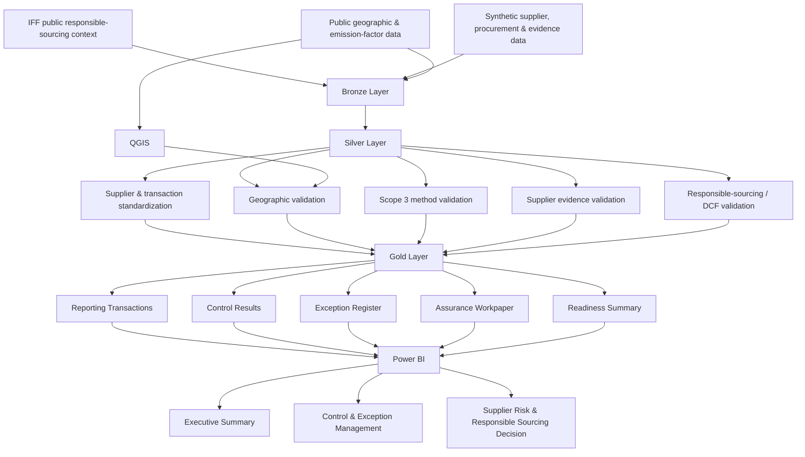

# Responsible Sourcing & ESG Assurance Architecture

This project connects responsible sourcing, supplier evidence, Scope 3 accounting, geospatial risk, data governance, and assurance controls in one governed workflow.



## Core Design Logic

The architecture separates four stages:

### 1. Source

The project combines:

- public responsible-sourcing context
- synthetic supplier and procurement data
- synthetic supplier evidence
- public geographic reference data
- public emission factors

### 2. Govern

Databricks Silver tables standardize and validate the records.

Key controls include:

- supplier and municipality validation
- emissions-method validation
- supplier-evidence validation
- sourcing-status validation
- price-year alignment

### 3. Assure

Gold tables turn validation results into:

- control outcomes
- exceptions
- remediation requirements
- reporting eligibility
- assurance-readiness conclusions

### 4. Decide

Power BI turns the governed data into three decision views:

1. Executive readiness
2. Control and exception management
3. Supplier risk and responsible-sourcing decisions

## Key Principle

The architecture deliberately separates:

**raw data → governed data → controlled data → reporting decision**

This prevents a value from becoming reportable simply because it exists or can be calculated.
```
